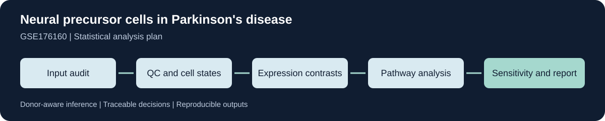

# pd-nsc-scrna

Parkinson's disease neural stem and precursor cell single-cell RNA-seq analysis.



A statistical case study of single-cell RNA sequencing in iPSC-derived human neural precursor cells from sporadic Parkinson's disease and control donors.

**Status:** Input audit, cell quality control, normalization, and PCA complete. Neighborhood graph construction and clustering are next.

## Research question

Which cell-state-specific expression and pathway differences distinguish sporadic Parkinson's disease from controls, and how consistent are these differences across donors and analytical choices?

## Study design

- Dataset: [GSE176160](https://www.ncbi.nlm.nih.gov/geo/query/acc.cgi?acc=GSE176160).
- Primary comparison: sporadic Parkinson's disease versus control in the patient-derived cohort.
- Primary cohort: 7 Parkinson's disease donors and 5 controls. All 12 donors are represented after cell filtering.
- Candidate focus: NSC1a, subject to annotation evidence and donor coverage.
- Biological replicate: donor. Cells are nested observations.
- Scope: metadata audit, quality control, normalization, cell-state annotation, descriptive composition, differential expression, pathway analysis, and sensitivity analysis.

## Project layout

| Path | Contents |
| --- | --- |
| `config/` | Analysis settings and input metadata |
| `data/raw/` | Unmodified downloaded inputs, local only |
| `data/interim/` | Intermediate objects, local only |
| `data/processed/` | Annotated analysis objects, local only |
| `notebooks/` | Concise exploratory analyses |
| `scripts/` | Reusable analysis and reporting scripts |
| `workflow/` | Workflow orchestration added as analysis steps mature |
| `results/figures/` | Generated analytical figures |
| `results/tables/` | Generated statistical tables |
| `assets/readme/` | Curated graphics displayed on this page |
| `references/` | Bibliography, local PDFs, and supplementary material |
| `docs/` | Project charter, decision log, and versioned Word report |

## Reproducibility

Use Python 3.12 and install the locked analysis environment with `uv`. On the development Mac, the environment lives on the internal drive to avoid package installation issues on the external SSD.

```bash
uv venv --python 3.12 "$HOME/.venvs/pd-nsc-scrna"
uv pip sync requirements.lock --python "$HOME/.venvs/pd-nsc-scrna/bin/python" --link-mode copy
"$HOME/.venvs/pd-nsc-scrna/bin/python" scripts/download_data.py
"$HOME/.venvs/pd-nsc-scrna/bin/python" scripts/audit_data.py
```

The input archive is approximately 238 MB and expands to 7.21 GB. Allow space for both files and the Python environment. The audit reads the dense matrix in chunks and preserves the input. On external filesystems with large allocation units, a Python environment can occupy substantially more disk space than its package payload.

Select this environment as the notebook kernel and run the notebooks in order.

1. [01 Data Inspection](notebooks/01_data_inspection.ipynb) audits the input and summarizes cell quality metrics.
2. [02 Quality Control](notebooks/02_quality_control.ipynb) writes the filtered raw counts to `data/interim/GSE176160_patients_qc.h5ad` for count-based statistical analyses.
3. [03 Normalization](notebooks/03_normalization.ipynb) scales each cell to 10,000 counts and applies `log1p`. It writes the expression matrix for PCA to `data/interim/GSE176160_patients_normalized.h5ad`.
4. [04 HVG Selection and PCA](notebooks/04_hvg_pca.ipynb) selects 2,000 highly variable genes and computes 50 PCs. It writes the expression matrix and PCA coordinates to `data/interim/GSE176160_patients_pca.h5ad`.

See the [input audit](docs/data_audit.md), [QC review](docs/qc_review.md), and [retention table](results/tables/qc_retention_by_condition.csv) for the evidence behind the retained cohort. The primary analysis retains 30,589 cells. The doublet sensitivity analysis retains 30,576 cells. See [Report Build](docs/report_build.md) for the Word report regeneration command.

Before `log1p`, the median scaled total was approximately 10,000 in each of the six lanes. See the [normalization summary by lane](results/tables/normalization_by_lane.csv).

The first 10 PCs explain 38.84% of the variance among the 2,000 selected genes. The six lanes overlap visually on PC1 and PC2. After accounting for donor, the largest lane contribution was 2.09% of the remaining variance in PC37. Two control donors account for 49.3% of cells in the lowest PC2 quintile. See the [PCA diagnostics](results/tables/pca_variance_and_lane.csv) and the [PCA plots by lane, donor, and condition](results/figures/pca_by_lane_donor_condition.png).

## Milestones

- [x] Define the statistical scope and repository structure.
- [x] Audit metadata, donor assignments, and count matrices.
- [x] Document cell QC decisions and write the filtered count matrix.
- [x] Normalize counts and verify scaling by lane.
- [x] Select highly variable genes and assess lane-associated variation with PCA.
- [ ] Construct the neighborhood graph and assess cluster composition.
- [ ] Annotate cell states.
- [ ] Freeze the statistical analysis plan.
- [ ] Complete differential expression and pathway analyses.
- [ ] Assess sensitivity and deliver the statistical report.

## Reference

Schmidt S, Luecken MD, Trumbach D, et al. Primary cilia and SHH signaling impairments in human and mouse models of Parkinson's disease. Nature Communications. 2022;13:4819. [doi:10.1038/s41467-022-32229-9](https://doi.org/10.1038/s41467-022-32229-9).

The study and published code will be credited wherever reused. Reference files retain their original rights and attribution.
